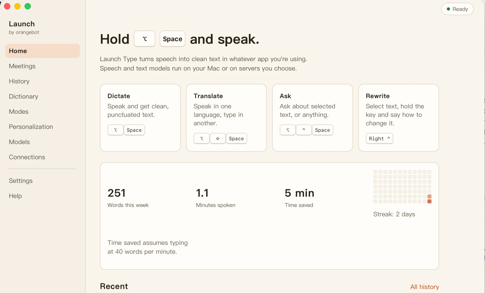

# Orangebot Launch

Launch is a desktop launcher for AI tasks: press a key in any app, the task runs on a local or cloud provider, the result lands back where you were. First tools: Launch Type (voice typing) and Launch Meeting (live transcription).



Launch by orangebot — an open-source local-model launcher. Hold a key, speak, and clean text lands in whatever box you were typing in. Runs local speech and text models with one-click install, or connects to your own OpenAI-compatible servers (base URL, model and key set separately for speech and text).

- Rust core and Rust UI (Tauri 2 + Leptos); macOS first, Windows next
- Platform layer: verified downloads (SHA-256, resumable), managed local services on loopback ports, endpoint tests
- Tools are plugins on the platform (`ob-tools`): **Launch Type** first; read (TTS), scan (OCR) and file Q&A later
- No account, no quota; strict-local mode keeps audio and text on your Mac

Status: pre-alpha.

## Layout

| Path | What |
|---|---|
| `crates/ob-domain` | config schema, data paths |
| `crates/ob-models` | model catalog, verified downloader, runtime installer (llama.cpp) |
| `crates/ob-providers` | OpenAI-compatible chat / transcription / model-list client |
| `crates/ob-runtime` | sidecar supervisor and port probing |
| `crates/ob-tools` | tool manifests, capabilities, registry |
| `crates/ob-type` | Launch Type (voice typing): session state machine, prompts |
| `crates/ob-audio`, `ob-platform`, `ob-platform-macos` | microphone, text insertion |
| `crates/ob-storage`, `ob-ipc` | SQLite history + dictionary, typed UI ↔ shell IPC |
| `apps/ob-asr-server` | local whisper.cpp server (Metal) with an OpenAI-compatible `/v1/audio/transcriptions` |
| `apps/ob-cli` | `ob` command for models, endpoint tests, recording and dictation |
| `apps/desktop`, `apps/ui` | Tauri shell and Leptos UI (main window + voice bar) |

## Develop

Requirements: Rust stable, `cmake`, `trunk`, `rustup target add wasm32-unknown-unknown`.

```bash
cargo test --workspace
cargo build -p ob-asr-server -p ob-cli
cd apps/desktop && cargo tauri dev
```

CLI end-to-end (any OpenAI-compatible servers work):

```bash
ob models download whisper-turbo-q5
ob-asr-server --model "$HOME/Library/Application Support/orangebot/models/whisper-turbo-q5/ggml-large-v3-turbo-q5_0.bin"
OB_ASR_URL=http://127.0.0.1:17860/v1 OB_LLM_URL=http://127.0.0.1:11434/v1 OB_LLM_MODEL=qwen3 ob dictate --seconds 5
```

macOS asks for Microphone access on first recording and Accessibility access before inserting text.

License: Apache-2.0 (planned).
